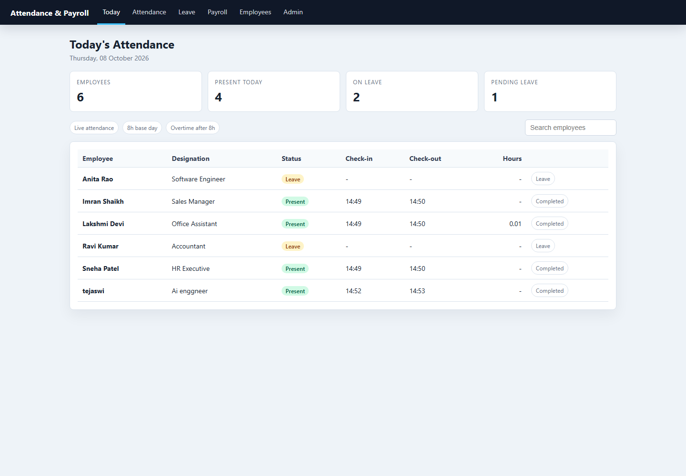
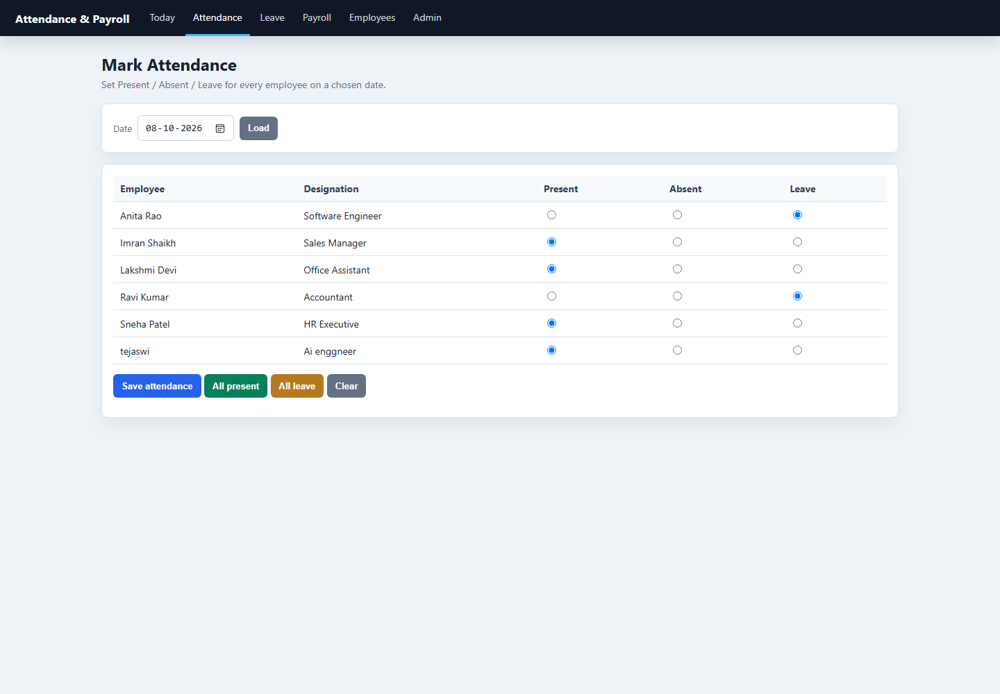
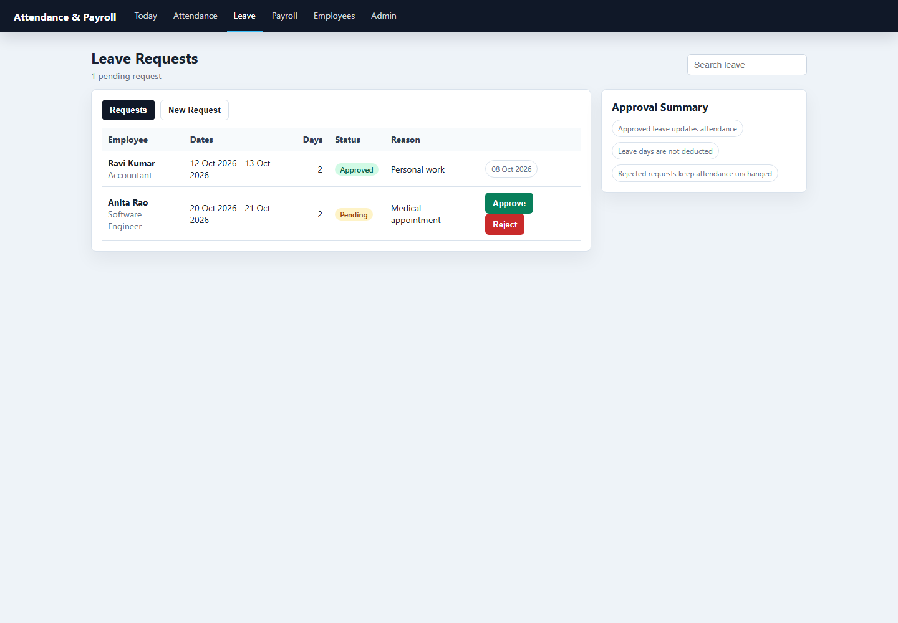
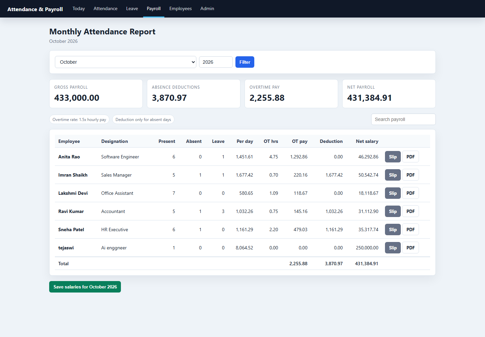
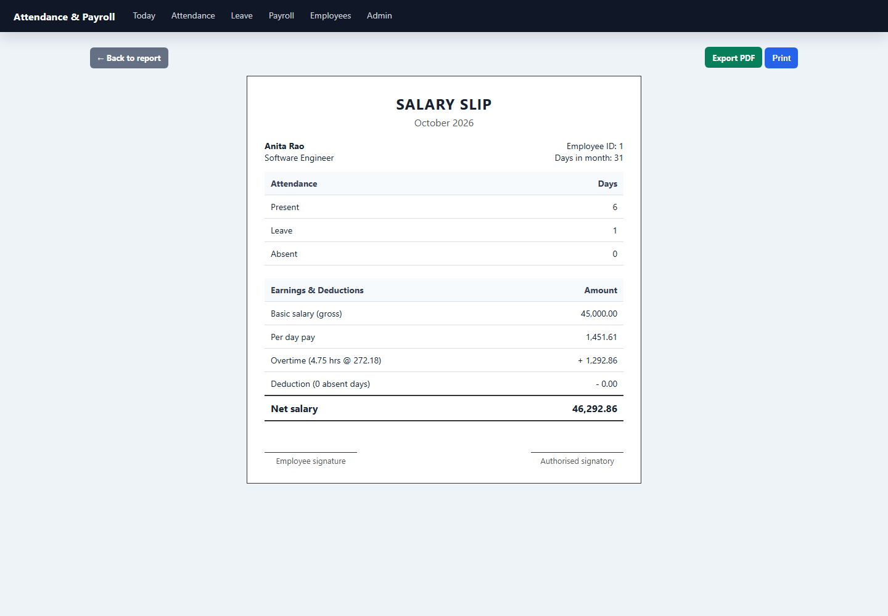
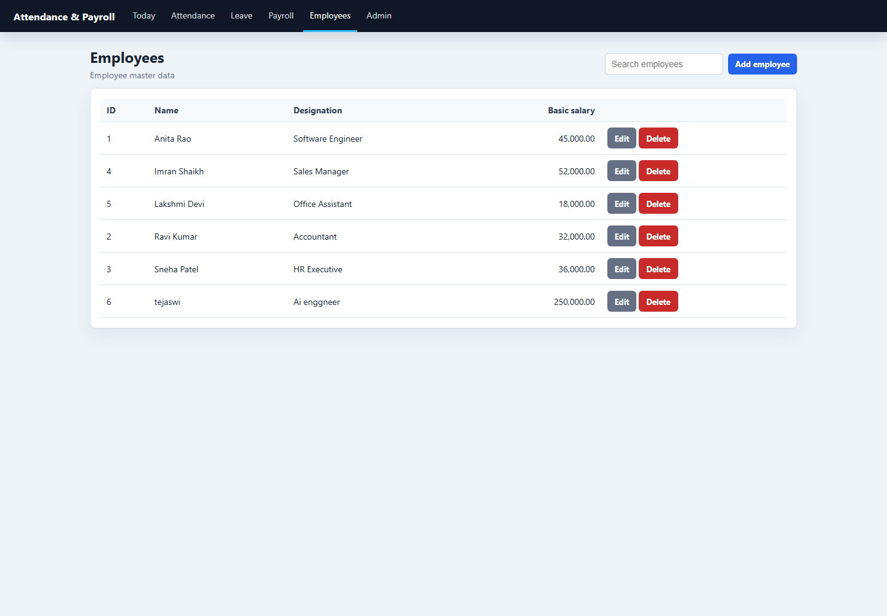

# Employee Attendance and Payroll

A Django application for managing employee attendance, leave requests, monthly payroll, and salary slips.

## Features

- Attendance dashboard with daily metrics and employee search.
- Bulk attendance entry for a selected date.
- Leave request submission, approval, and rejection.
- Approved leave automatically updates attendance records.
- Monthly payroll reports with absence deductions and overtime pay.
- Printable salary slips and PDF downloads.

## Requirements

- Python 3
- Dependencies listed in `requirements.txt`

## Setup

From the project directory, create and activate a virtual environment, then install the dependencies:

```powershell
python -m venv venv
.\venv\Scripts\Activate.ps1
pip install -r requirements.txt
```

Create the database tables and optionally load demo data:

```powershell
python manage.py migrate
python manage.py seed_demo
```

Start the development server:

```powershell
python manage.py runserver
```

Open <http://127.0.0.1:8000/> in your browser. To use Indian local time, set the time zone before starting the server:

```powershell
$env:TIME_ZONE = "Asia/Kolkata"
python manage.py runserver
```

## Pages

| URL | Purpose |
| --- | --- |
| `/` | Today's attendance dashboard |
| `/attendance/mark/` | Bulk attendance entry |
| `/leave/` | Leave requests and approvals |
| `/report/?month=10&year=2026` | Monthly payroll report |
| `/payslip/<employee_id>/?month=10&year=2026` | Web salary slip |
| `/payslip/<employee_id>/pdf/?month=10&year=2026` | PDF salary slip |
| `/employees/` | Employee records |

## Payroll rules

- Daily pay is the basic salary divided by the number of days in the month.
- Absence deduction is the number of absent days multiplied by daily pay.
- Approved leave is not deducted.
- Overtime is time worked beyond 8 hours per day and is paid at 1.5 times the hourly rate.
- Net salary is basic salary minus absence deduction plus overtime pay.

## Screenshots

| Dashboard | Attendance |
| --- | --- |
|  |  |

| Leave requests | Payroll report |
| --- | --- |
|  |  |

| Salary slip | Employees |
| --- | --- |
|  |  |

## Tests

Run the Django test suite with:

```powershell
python manage.py test
```

This project uses SQLite for local development. The database file, virtual environment, and generated PDF/temp files are excluded from version control.
